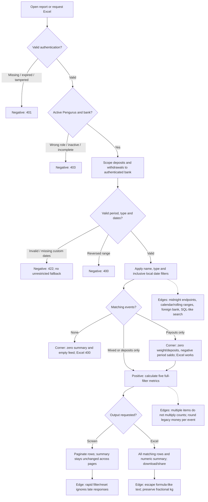

# PIL-248 operational summary and Excel

Branch `feature/pil-248` starts from staging `d8bb1f2` (merged PIL-246).

## Contract

`GET /api/v1/aktivitas` preserves its pagination/envelopes and adds `summary` for
**all matching events**, independent of `page` and `page_size`:

```json
{"jumlah_transaksi":3,"total_berat":"3.500","total_setoran":20000,"total_pencairan":5000,"saldo":15000}
```

Transaction count includes deposits and withdrawals, not detail rows. Weight
comes only from matching deposit items. Money is integer Rupiah, rounded per
event for legacy fractional records. `saldo` is filtered deposits minus filtered
gross withdrawals, **not** the live bank/member balance or net cash paid after
withdrawal deductions. An empty result returns zero metrics.

Filters are identical to PIL-246: `periode`, inclusive custom `dari_tanggal` /
`sampai_tanggal`, `tipe`, optional `nasabah_id`, and case-insensitive trimmed name `search`. Defaults are
`semua`; the frontend explicitly sends its selected period. Access is limited to
an active, profile-complete Pengurus and their authenticated bank. A client bank
override never determines scope.

`GET /api/v1/transaksi/export` now includes both sources with those same filters;
pagination parameters do not truncate the export. Existing download filename and
MIME type remain XLSX. No matching events returns the existing 400 Indonesian
error. A payout-only result is exportable.

Workbook sheets:

- `Laporan`: existing waste-category breakdown (preserved for existing consumers).
- `Riwayat Transaksi`: original first ten columns, then activity type, deposit
  value, withdrawal value and activity ID. Each deposit item has a raw row; a
  deposit's total is written once in its deposit-value column to avoid inflation.
  Withdrawals and detail-less legacy deposits have one row. Ordering matches the
  activity feed. Per-event balance snapshots differ from the period net summary.
- `Ringkasan`: the five operational metrics as numeric values, available without
  requiring Excel formula recalculation. `Saldo periode` makes its scope explicit.

## Explicit TDD history

1. **RED** `900e60a`: tests only, run before implementation. The 17 new contract
   test methods produced six failure events and 17 errors (including subtests):
   missing response summary/workbook metrics, ignored type filter, unsafe Excel
   text and missing privacy headers. Existing authorization assertions already
   passed. The inherited workbook assertion was updated for the new third sheet.
2. **GREEN**: implement the response, shared totals and combined workbook until
   the reporting/ledger/API/architecture checks pass. New tests cover success,
   invalid filters, empty/payout-only data, boundaries, precision, page-independent
   totals, SQL-like search, formula-like input, bank isolation and JWT rejection.
3. **REFACTOR**: recorded separately after GREEN; preserve the test contract while
   extracting the shared activity-source query and reducing unnecessary data
   materialization. Before: reporting loaded every combined activity ID and rebuilt
   two source queries. After: `operational_queries` delegates to `activity_sources`,
   the same ledger-owned policy used by `activity_query`. This applies DRY and
   single responsibility while preserving public bounded-context ports. Monetary
   totals stream values through the existing `bulatkan_rupiah` policy instead of
   retaining an unbounded result cache. See the in-chat before/after explanation.

Browser/corner-case follow-up cycle: **RED** `d2b4b43` proves that an export
containing only withdrawals writes the circular formula `=SUM(E2:E1)` into E2 of
the preserved category sheet. **GREEN** `3f568d7` writes numeric zero when there
are no deposit categories (all 30 reporting tests pass). **REFACTOR** then extracts
`_fill_operational_summary_sheet` from workbook assembly (single responsibility),
with the before/after snippet explained in chat before committing. The first
cycle's OWASP controls remain in force.

Filter metadata follow-up: **RED** `396f208` reproduces five incorrect labels:
rolling 1/3/6/12-month exports say all time, and the operational default says today.
**GREEN** `5c5e188` corrects those labels (31 reporting tests pass). **REFACTOR**
moves fallback selection into `period_label(request, default="semua")` while
preserving the legacy formatter default for other callers. This is correctness
and single responsibility, not an additional security mitigation. The five
security controls above are established by the first GREEN tests.

## Security evidence: OWASP Top 10:2025

Reference: https://top10.owasp.org/2025/0x00_2025-Introduction/
These are concrete mitigations for five categories, not a claim to eliminate
every weakness in those categories or a penetration-test certification.

| Category | Control and regression evidence |
|---|---|
| A01 Broken Access Control | Existing `IsActivePengelola`, authenticated bank scoping on both sources; test foreign-bank fixtures, client bank overrides, nasabah/superadmin and inactive bank/incomplete manager. |
| A02 Security Misconfiguration | Financial success responses explicitly use `Cache-Control: private, no-store` and `X-Content-Type-Options: nosniff`; test both endpoints. This does not assert deployment TLS/CORS configuration is fully secure. |
| A05 Injection | ORM parameterized name filtering; SQL-like search cannot bypass filters. Escape formula-like customer/member/waste text as spreadsheet text; test `=`, `+`, `-`, `@` and tab prefixes. Trusted existing category formulas are not user-provided expressions. |
| A07 Authentication Failures | Reuse existing JWT authentication and test missing, expired and malformed/tampered bearer tokens return 401. No custom authentication implementation is introduced. |
| A10 Mishandling of Exceptional Conditions | Invalid period/type/dates fail closed with 422; reversed ranges return 400; empty export returns its existing controlled error. No silent fallback to unrestricted export. |

## Test-case flow



Frontend state/export tests complement backend tests: loading, error, empty and
negative saldo display; strict summary parsing; stale requests; type/name export
filters; desktop and narrow responsive layouts.

## Validation notes

Runtime: Python 3.12.4 and Django 6.0.8 from the existing ignored PIL-246 virtual
environment. No dependencies, credentials or generated runtime files committed.
Run commands with `DJANGO_DEBUG=true` and an ephemeral test-only secret in the
environment (never committed or printed).

- `python manage.py test apps.reporting apps.ledger tests.test_api tests.test_architecture --noinput`: 347 tests pass before refactoring.
- `python manage.py test --noinput`: 639 tests run; four failure events in three
  unrelated deployment test methods on Windows. An untouched staging archive
  reproduces the same four events (nine deployment test methods run): Windows
  permission bits differ from POSIX 0600, and Bash deployment validation produces
  no expected stderr on this host. Do not report the complete suite as green.
- After refactoring: the same 347 reporting/ledger/API/architecture tests pass;
  the full 639-test run reproduces only those same four deployment failure
  events. Existing failures are not skipped or modified.
- After the payout-only follow-up: 348 reporting/ledger/API/architecture tests
  pass; Ruff formatting/lint and the same 177-file strict mypy check pass.
- After filter metadata follow-up: 349 reporting/ledger/API/architecture tests
  pass, including both new regressions; Ruff and strict mypy177 also pass.
- Final implementation head `312478f`: the documented full Django test command
  runs 641 tests and reproduces only the same four baseline Windows deployment
  failure events. The passing focused set is 349 tests; do not describe the
  entire backend suite as green.
- Ruff lint and formatting pass. Exact CI type check
  `mypy api apps config shared_kernel tests`: 177 source files pass.
- `python manage.py makemigrations --check --dry-run`: no changes detected;
  `python manage.py check`: no issues.
- A fresh ignored SQLite database and synthetic Pengurus fixtures were used
  with the real frontend build in Playwright at 1440x1000 and 360x800. Desktop
  and narrow layouts show the five totals without overflow; type/name filters
  produce the expected negative balance for payout-only results.

Real browser verification also reproduced an inherited frontend limitation:
native filesystem saving on the web returned no download after a successful
XLSX request. The frontend has its own second RED/GREEN/REFACTOR cycle to select
native filesystem versus browser Blob saving and to share browser bytes instead
of a nonexistent local path. Actual browser download now succeeds. Opening that
download with openpyxl confirms exactly two selected-customer withdrawals
(Rp5,000 and Rp7,000), zero weight/deposits, total withdrawals Rp12,000 and period
saldo -Rp12,000. The preserved empty category sheet contains numeric zero.

Playwright checks cover all five totals, type/name filtering, empty, loading,
503 error and retry at 1440x1000 and 360x800, with no page errors. The Bagikan
action is verified through a local replacement for the operating-system share
API; file name, XLSX MIME and real bytes are checked without sending a file to
any external recipient. Screenshots/workbooks remain outside Git as required.

## Final cross-repository evidence

Frontend implementation head: `be5460bdde9f8855bebcd7c55211a135247a1b5e`.
Both repositories use `feature/pil-248`, created from their fetched staging heads.

| Repository / cycle | RED | GREEN | REFACTOR |
|---|---|---|---|
| Backend summary/export | `900e60a` | `97c0eae` | `1192e11` |
| Backend payout-only workbook | `d2b4b43` | `3f568d7` | `a5a6bc8` |
| Backend period metadata | `396f208` | `5c5e188` | `312478f` |
| Frontend summary/export | `3d28b38` | `e0ad5b6` | `d5e7bee` |
| Frontend browser saving/sharing | `427523c` | `d62a831` | `be5460b` |

The browser-saving RED commit records the observed release-browser failure
(HTTP 200 but no download); it does not misrepresent local Flutter Chrome
bootstrap errors as product test failures. Before each refactor, the principles
and actual before/after code were explained in the conversation.

Final frontend verification: 1,913 passing Flutter tests and one existing skip;
analyzer clean; exact CI formatter checks 627 files without changes; web release
build passes. Eight portable pipeline tests pass. Docker-based checks and
actionlint were unavailable locally. Chrome regression tests are included in
the existing Linux CI steps, but that remote CI has not run for these local
commits. Local Windows Flutter Chrome test bootstrap is blocked by SDK asset-path
handling; actual Playwright verification of the final release build passes.

Final VM-LCOV coverage measures 114/115 changed executable lines. The browser-only
downloader and legacy export-sheet helper are absent from VM LCOV, so this is not
a whole-branch 100% coverage claim. Browser behavior is verified separately; no
coverage exclusions or gate thresholds were changed.

Android debug APK was attempted. A process-only JDK21 override resolved the local
Java25/Gradle incompatibility, after which the build reached
`:app:processDebugGoogleServices` and failed because `google-services.json` is
absent. The user's existing waiver applies; native APK validation is not claimed.

Final Playwright checks compare the downloaded XLSX and Bagikan attachment using
SHA-256 as well as filename and MIME. They match exactly. The workbook contains
only the selected customer's two withdrawals and the matching -Rp12,000 period
balance. Desktop, mobile, empty, loading, error and retry screenshots are retained
outside the repositories.

No remote push, PR creation, merge or deployment is implied by these local commits.


## Review regressions: member scope and snapshot consistency

`nasabah_id` intersects the authorized bank and any existing member scope for
both deposits and payouts. It never replaces authorization scope. Malformed IDs
return a field validation error; valid foreign/unknown members cannot export
another member's data. Two-member tests verify all workbook sheets and totals.

`export_operational_report` is the reporting port for the complete operational
export. It starts an outermost read-only PostgreSQL `REPEATABLE READ` transaction
before any report query, then performs emptiness checks, summary aggregates,
category totals, detail reads, running balances and workbook generation within
that snapshot. This requires a fresh top-level transaction, not an enclosing
`READ COMMITTED` block. A durable atomic boundary rejects unsupported nesting;
export integration tests use real transaction boundaries accordingly. The
transaction settings apply to this operation only and are restored on exit.

Real PostgreSQL regressions commit an insert and a transaction/detail edit from
a separate connection between summary calculation and workbook rows. Each
workbook retains its original coherent values; the next export sees the committed
change. Additional checks prove read-only enforcement, rollback cleanup and
rejection of a preexisting transaction. SQLite does not substitute for these
PostgreSQL concurrency checks.
