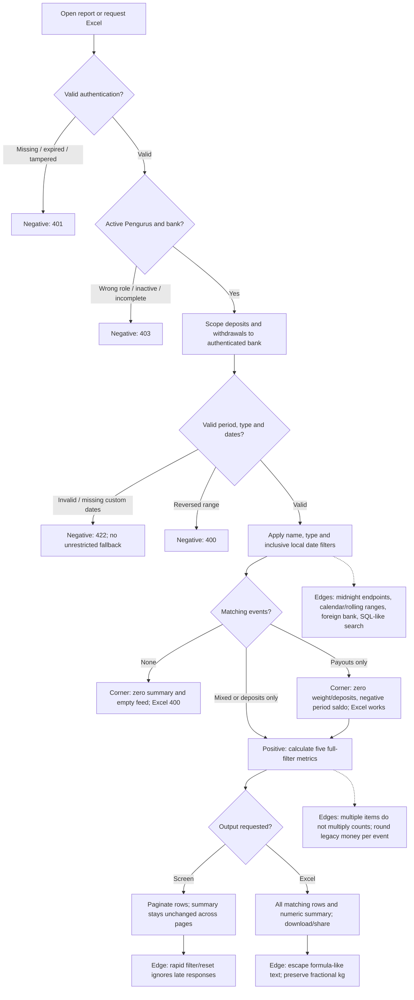

# PIL-248 operational summary and Excel

Branch `feature/pil-248` starts from staging `d8bb1f2` (merged PIL-246).

## Contract

`GET /api/v1/aktivitas` preserves its pagination/envelopes and adds `summary` for
**all matching events**, independent of `page` and `page_size`:

```json
{"jumlah_transaksi":3,"total_berat":"3.500","total_setoran":20000,"total_pencairan":5000,"saldo":15000}
```

Transaction count includes deposits and withdrawals, not detail rows. Weight
comes only from matching deposit items. Money is integer Rupiah, rounded per
event for legacy fractional records. `saldo` is filtered deposits minus filtered
gross withdrawals, **not** the live bank/member balance or net cash paid after
withdrawal deductions. An empty result returns zero metrics.

Filters are identical to PIL-246: `periode`, inclusive custom `dari_tanggal` /
`sampai_tanggal`, `tipe` and case-insensitive trimmed name `search`. Defaults are
`semua`; the frontend explicitly sends its selected period. Access is limited to
an active, profile-complete Pengurus and their authenticated bank. A client bank
override never determines scope.

`GET /api/v1/transaksi/export` now includes both sources with those same filters;
pagination parameters do not truncate the export. Existing download filename and
MIME type remain XLSX. No matching events returns the existing 400 Indonesian
error. A payout-only result is exportable.

Workbook sheets:

- `Laporan`: existing waste-category breakdown (preserved for existing consumers).
- `Riwayat Transaksi`: original first ten columns, then activity type, deposit
  value, withdrawal value and activity ID. Each deposit item has a raw row; a
  deposit's total is written once in its deposit-value column to avoid inflation.
  Withdrawals and detail-less legacy deposits have one row. Ordering matches the
  activity feed. Per-event balance snapshots differ from the period net summary.
- `Ringkasan`: the five operational metrics as numeric values, available without
  requiring Excel formula recalculation. `Saldo periode` makes its scope explicit.

## Explicit TDD history

1. **RED** `900e60a`: tests only, run before implementation. The 17 new contract
   test methods produced six failure events and 17 errors (including subtests):
   missing response summary/workbook metrics, ignored type filter, unsafe Excel
   text and missing privacy headers. Existing authorization assertions already
   passed. The inherited workbook assertion was updated for the new third sheet.
2. **GREEN**: implement the response, shared totals and combined workbook until
   the reporting/ledger/API/architecture checks pass. New tests cover success,
   invalid filters, empty/payout-only data, boundaries, precision, page-independent
   totals, SQL-like search, formula-like input, bank isolation and JWT rejection.
3. **REFACTOR**: recorded separately after GREEN; preserve the test contract while
   extracting the shared activity-source query and reducing unnecessary data
   materialization. Before: reporting loaded every combined activity ID and rebuilt
   two source queries. After: `operational_queries` delegates to `activity_sources`,
   the same ledger-owned policy used by `activity_query`. This applies DRY and
   single responsibility while preserving public bounded-context ports. Monetary
   totals stream values through the existing `bulatkan_rupiah` policy instead of
   retaining an unbounded result cache. See the in-chat before/after explanation.

## Security evidence: OWASP Top 10:2025

Reference: https://top10.owasp.org/2025/0x00_2025-Introduction/
These are concrete mitigations for five categories, not a claim to eliminate
every weakness in those categories or a penetration-test certification.

| Category | Control and regression evidence |
|---|---|
| A01 Broken Access Control | Existing `IsActivePengelola`, authenticated bank scoping on both sources; test foreign-bank fixtures, client bank overrides, nasabah/superadmin and inactive bank/incomplete manager. |
| A02 Security Misconfiguration | Financial success responses explicitly use `Cache-Control: private, no-store` and `X-Content-Type-Options: nosniff`; test both endpoints. This does not assert deployment TLS/CORS configuration is fully secure. |
| A05 Injection | ORM parameterized name filtering; SQL-like search cannot bypass filters. Escape formula-like customer/member/waste text as spreadsheet text; test `=`, `+`, `-`, `@` and tab prefixes. Trusted existing category formulas are not user-provided expressions. |
| A07 Authentication Failures | Reuse existing JWT authentication and test missing, expired and malformed/tampered bearer tokens return 401. No custom authentication implementation is introduced. |
| A10 Mishandling of Exceptional Conditions | Invalid period/type/dates fail closed with 422; reversed ranges return 400; empty export returns its existing controlled error. No silent fallback to unrestricted export. |

## Test-case flow



Frontend state/export tests complement backend tests: loading, error, empty and
negative saldo display; strict summary parsing; stale requests; type/name export
filters; desktop and narrow responsive layouts.

## Validation notes

Runtime: Python 3.12.4 and Django 6.0.8 from the existing ignored PIL-246 virtual
environment. No dependencies, credentials or generated runtime files committed.
Run commands with `DJANGO_DEBUG=true` and an ephemeral test-only secret in the
environment (never committed or printed).

- `python manage.py test apps.reporting apps.ledger tests.test_api tests.test_architecture --noinput`: 347 tests pass before refactoring.
- `python manage.py test --noinput`: 639 tests run; four failure events in three
  unrelated deployment test methods on Windows. An untouched staging archive
  reproduces the same four events (nine deployment test methods run): Windows
  permission bits differ from POSIX 0600, and Bash deployment validation produces
  no expected stderr on this host. Do not report the complete suite as green.
- After refactoring: the same 347 reporting/ledger/API/architecture tests pass;
  the full 639-test run reproduces only those same four deployment failure
  events. Existing failures are not skipped or modified.
- Ruff lint and formatting pass. Exact CI type check
  `mypy api apps config shared_kernel tests`: 177 source files pass.
- `python manage.py makemigrations --check --dry-run`: no changes detected;
  `python manage.py check`: no issues.
- A fresh ignored SQLite database and synthetic Pengurus fixtures were used
  with the real frontend build in Playwright at 1440x1000 and 360x800. Desktop
  and narrow layouts show the five totals without overflow; type/name filters
  produce the expected negative balance for payout-only results.

No remote push, PR creation, merge or deployment is implied by these local commits.
