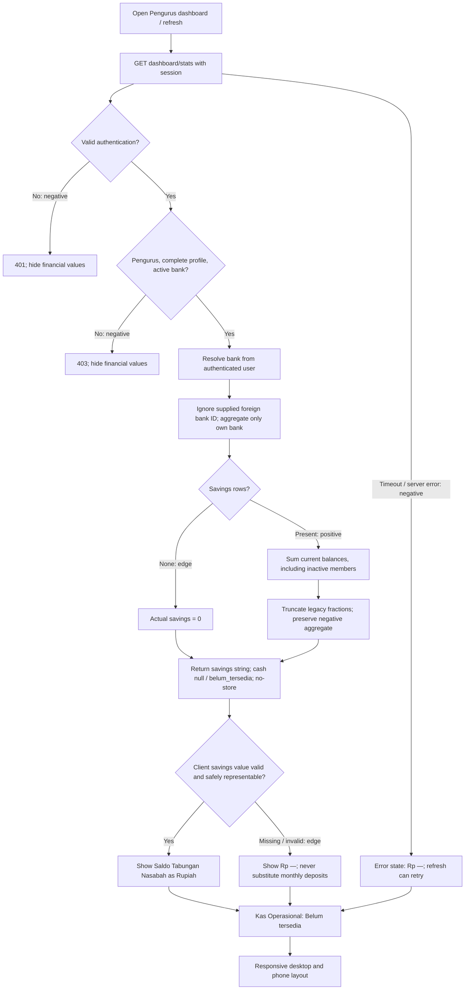

# Dashboard balance separation

Baseline reviewed: backend staging `5db5aa0`, Flutter staging `a564f9a5`.

## Business decision and API contract

Customer savings are money owed to customers. They are not operational cash.
The approved scope displays actual savings and labels cash **Belum tersedia**
until a cash ledger exists. It does not introduce cash entry or editing.

`GET /api/v1/dashboard/stats` retains the existing monthly fields and adds:

```json
{
  "total_saldo_nasabah": "9876543",
  "kas_operasional": null,
  "kas_operasional_status": "belum_tersedia"
}
```

Savings sum current `Saldo.total_saldo` for memberships belonging to the
authenticated manager's bank, including inactive memberships. This is an
all-time current balance, independent of this month's deposit total. Legacy
fractions are truncated once after aggregation with `bulatkan_rupiah`; reads
never mutate stored balances. Empty banks return savings `"0"`, while cash
remains null. Negative legacy balances remain visible for investigation.
The aggregate is serialized as a decimal integer string rather than a float.

The new UI labels the old monthly metric **Nilai Setoran Bulan Ini**. The API
field `total_nilai_bulan_ini` is retained for existing clients. Older clients
retain their old label until updated. This change does not implement a cash
ledger or assert that the old monthly figure measures cash.

## Positive, negative, and edge-case flow



## Explicit TDD record

### Reconstructed commit sequence

At the user's request, the original published implementation was reconstructed
into three explicit commits and each phase was rerun. This is a newly verified
history, not a claim that the initial development used separate phase commits.
The original published head is retained at `codex/dashboard-balance-before-tdd`.

- **Red** `d8d9bfd`: typed balance-contract tests on the original staging code;
  10 tests run, with 1 failure and 6 errors for missing fields/header.
- **Green** `0903587`: scoped savings, unavailable cash and no-store responses;
  all 33 balance/reporting/architecture tests pass. Whole Rupiah is initially
  obtained directly with `int(savings)`.
- **Refactor** (this commit): replace direct truncation with the existing
  `bulatkan_rupiah` helper and add the implementation/security evidence. All
  33 regression tests still pass. Production code is identical to the previous
  PR head; only the commit structure and this explanation change.

1. **Red:** write backend contract and authorization tests before production
   changes. The unchanged endpoint fails on missing savings/cash fields and
   Cache-Control. Write a widget test requiring distinct savings and cash
   cards; the unchanged widget cannot find the savings amount.
2. **Green:** add the scoped aggregate, explicit unknown cash contract and
   private no-store response. Wire savings through the remote source, entity,
   cubit and state. Render separate cards; relabel monthly deposits.
3. **Refactor:** centralize savings display behavior shared by phone and web,
   use the existing currency formatter, format the code, then rerun regression
   tests and required checks. Keep unknown savings distinct from real zero.

The backend reuses `shared_kernel.kalkulasi.bulatkan_rupiah` rather than
introducing a second rounding rule. The mobile
`dashboard_balance_display.dart` helper centralizes nullable savings text so
phone and web agree on valid zero, negative values and unavailable data.
This refactor preserves behavior established by the green tests; the extra
narrow-layout tests protect the shared formatting at phone width. The new
tests and existing reporting/architecture tests were rerun after refactoring.
The TDD flow image accompanies the PR evidence; it includes authorization
failure, empty-bank, malformed-response and network-failure branches as well
as the successful aggregate path.

Test source: `apps/reporting/test_dashboard_balances.py`; Flutter regression
tests live under `test/features/dashboard/`. Execution logs and actual UI
captures are retained outside the application repositories in workspace
`reports/`. Setup failures are not counted as red test results.

Recorded execution on 23 October 2026:

| Phase/check | Observed result |
| --- | --- |
| Backend red | 10 tests; 1 failure and 6 errors on missing contract/header, before production edits. One fixture also needed a unique email before green. |
| Flutter red | Required savings amount is absent from the unchanged dashboard widget. |
| Backend green | All 10 new tests pass. |
| Backend refactor/regression | 33 balance, reporting and architecture tests pass; Ruff passes. |
| Final backend ship check | After adding API-test fixture annotations, all 33 regression tests still pass; strict `mypy api apps config shared_kernel tests` passes across 213 source files. |
| Flutter green/refactor | All 84 initial dashboard tests pass; all 87 pass after the display refactor and additional narrow-layout cases for missing, zero and negative savings. |
| Full backend suite | 818 tests run, 4 skipped, 5 reported failures. The same 5 failures reproduce in 12 deployment/bootstrap tests on unchanged staging. |
| Full Flutter suite | 2,663 passed, 1 skipped, 25 failed. All 25 failures reproduce in design/profile tests on unchanged staging (303 passed in that comparison subset). |
| Flutter static analysis | No issues found. |
| App web release | `flutter build web --release -t lib/main_development.dart` passes. |
| Android debug build | Default Flutter build stops on local JDK 25/Gradle compatibility. Retrying Gradle with process-local JDK 22 compiles Flutter, then stops at `processDebugGoogleServices` because the authorized `android/app/google-services.json` is absent. No Firebase config was fabricated. |
| Playwright | Actual component previews captured at 1440×1000 and 390×1000, before and after; no page errors. |

Baseline failures include Windows path separators in design scanners, profile
image tests, deployment shell expectations and Unix file-mode assumptions.
They are preserved rather than changed as part of a dashboard feature.

## OWASP analysis and prevention attempts

This is a focused implementation review, not a complete penetration test.
Categories follow the [OWASP API Security Top 10 (2023)](https://api-security.owasp.org/editions/2023/en/0x00-header/).

| Risk | Relevant failure scenario | Prevention and verification | Remaining limit |
| --- | --- | --- | --- |
| API1 Broken Object Level Authorization | A manager requests another bank's savings using a forged query parameter. | Resolve bank from the authenticated user; scope the aggregate by membership bank. Regression test creates foreign funds and supplies that bank's ID. | Managers of one bank intentionally see its aggregate. No cross-unit rollup is introduced. |
| API2 Broken Authentication | An anonymous caller or invalid bearer token obtains financial data. | Retain existing authentication and permission gates; test anonymous and malformed-token requests return 401. | Token lifecycle and deployment identity configuration remain existing system responsibilities. |
| API3 Broken Object Property Level Authorization | A dashboard response exposes individual balances or accepts a replacement total. | Explicit aggregate response fields; test exact response keys and POST rejection (405), then confirm stored balance is unchanged. | Existing bank and manager names remain part of the endpoint contract. |
| API4 Unrestricted Resource Consumption | The dashboard downloads every member or runs a query per customer. | Database SUM over the bank-scoped relation; no customer list, pagination loop or per-member query. | Aggregation still scans matching balances. This change adds no endpoint rate limiter; production request quotas and database sizing remain necessary. |
| API5 Broken Function Level Authorization | A customer or incomplete manager accesses the manager dashboard. | Retain IsActivePengelola; test wrong role, incomplete profile and inactive bank return 403. | This does not grant a new dashboard capability to other roles. |
| API6 Unrestricted Access to Sensitive Business Flows | Automated access might repeatedly inspect financial totals or abuse a future cash-entry operation. | This endpoint only reads a bank aggregate; the POST-rejection test demonstrates that it cannot alter balances. No cash-entry business flow is exposed. | No automation-specific quota or abuse monitoring is added. A future cash ledger needs idempotency, approval and audit requirements appropriate to its write operations. |
| API7 Server Side Request Forgery | A caller might try to make the backend fetch an attacker-selected URL. | The added calculation uses the local database and accepts no remote URL or outbound-fetch input. The new code introduces no SSRF fetch surface. | This is a code-path assessment, not an SSRF penetration test of other endpoints or infrastructure. |
| API8 Security Misconfiguration | A shared HTTP cache retains one bank's financial dashboard response. | Explicit `Cache-Control: no-store, private` on successful stats responses, covered by a regression test. | HTTPS, proxy behavior and existing client debug logging require deployment-wide review; they are not proven by this local change. |
| API9 Improper Inventory Management | Old clients or undocumented versions continue treating monthly deposits as cash. | Document the additive `/api/v1/dashboard/stats` fields, null cash status and retained monthly field here; the exact-key contract test tracks the response shape. Update the mobile label with this coordinated change. | Older deployed clients retain the old label until upgraded; deployed host/version inventory and retirement are outside this local feature. |
| API10 Unsafe Consumption of APIs | The client trusts missing or malformed financial values from an API response. | Defensive client parsing and display tests keep invalid/missing savings unavailable rather than substituting deposits or inventing a zero. The backend aggregate calls no third-party API. | This is defensive handling of the first-party contract, not proof of security for unrelated third-party integrations; no such integration is added. |

The table is an assessment of all ten API categories, not a claim that ten
exploitable vulnerabilities were discovered. Existing authentication and role
controls are retained; bank scoping and non-cacheable financial output are
verified for the new fields. The missing cash ledger is a deliberately deferred
business capability, not a security finding. Resource throttling, deployment
configuration and broader audit coverage remain unverified or out of scope.

Additional financial correctness safeguards: unknown cash is null rather than
zero; malformed or missing new savings values never fall back to monthly
transactions. These are business/data-integrity protections, not separate
claims of OWASP vulnerabilities.

## UI evidence

Before: one misleading **Total Kas Bulan Ini** card showing monthly deposit
value. After: **Saldo Tabungan Nasabah**, **Kas Operasional — Belum tersedia**,
and the separately named **Nilai Setoran Bulan Ini** metric.

The reproducible Flutter component preview is
`tool/dashboard_balance_preview.dart` in the mobile repository. Captures use
the actual widgets and fabricated demo values, not a live authenticated
staging session. Desktop and phone-sized browser evidence checks responsive
web components, not native Android behavior.

Screenshot filenames in workspace `reports/`: `dashboard-before-desktop.png`,
`dashboard-after-desktop.png`, `dashboard-before-phone.png`,
`dashboard-after-phone.png`. Playwright assertions and browser error records
are saved in `dashboard-before-browser-qa.json` and
`dashboard-after-browser-qa.json`.

Both application PRs use `codex/dashboard-balance-separation` and target
`staging`. This delivery does not merge or deploy the changes.

## Access and operational-cash input

1. Sign in to the updated application with a **Pengurus/Pengelola** account
   whose profile is complete and whose bank is active.
2. Open **Beranda** (`/dashboard` in the application router). A Nasabah account
   reaches its own customer home instead and cannot call this manager API.
3. Read **Saldo Tabungan Nasabah** for the current bank's total savings,
   **Nilai Setoran Bulan Ini** for this month's deposits, and **Kas Operasional**
   for the cash availability status. Opening or refreshing Beranda requests
   `GET /api/v1/dashboard/stats` with the existing authenticated session.

**Kas Operasional cannot be entered or edited in this implementation.** There
is no operational-cash ledger, input form or write endpoint. Its API value is
always `null` with `kas_operasional_status: "belum_tersedia"`, so the application
shows **Belum tersedia**, including when a bank has no customers. Customer
savings and monthly deposits must not be entered as a substitute cash amount.
The screenshots with Rp 2.500.000 and Rp 0 are fabricated component-preview
states only; they do not demonstrate a saved cash transaction or an available
cash-entry workflow. A later ledger feature must define opening balances,
receipts, expenses, bank isolation, permissions and audit history before a real
cash balance can replace this status.

## Sonar and delivery limits

Existing staging Sonar results report backend line coverage of 99.8% and zero
open/confirmed issues, predating this feature. Local changed-line coverage is
4/4 instrumented backend production lines (100%); it is not Sonar's new-code
coverage or a new-code quality-gate verdict. The user declined the local
Sonar agentic source upload, so that scan was not run. Repository CI may run its
normally configured scans when the branch is pushed.

Required full-suite checks were run and baseline failures were reproduced on
unchanged staging. Coordinated delivery also has an unresolved Android build
prerequisite: the authorized `android/app/google-services.json` is absent. The
user explicitly approved opening both PRs with this validation gap documented.
The Android APK build and native verification have not completed without the
authorized Firebase config. No config was fabricated, no successful APK is
claimed, and the missing validation must be resolved before release.
