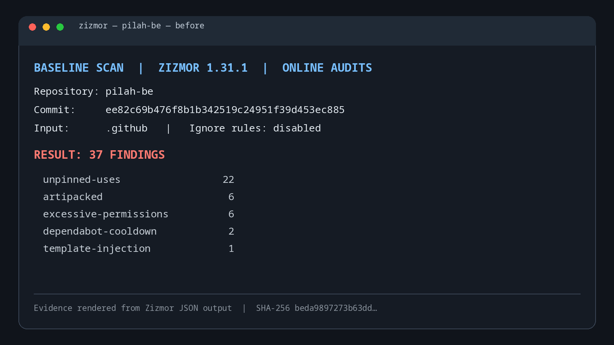
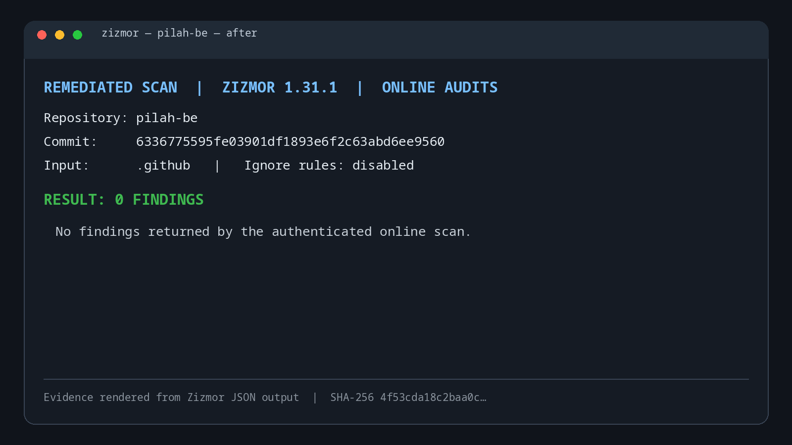

# Zizmor CI remediation — pilah-be

The authenticated online Zizmor scan went from **37 findings** on the `staging` baseline to **0 findings** after remediation. Scans used Zizmor `1.31.1`, included online audits, scanned `.github`, and disabled ignore rules. No findings were suppressed.

- Baseline `origin/staging`: `ee82c69b476f8b1b342519c24951f39d453ec885`
- Remediation commit: `6336775595fe03901df1893e6f2c63abd6ee9560`
- Scan date: 2026-11-02

## Before



| Audit | Findings |
| --- | ---: |
| `artipacked` | 6 |
| `dependabot-cooldown` | 2 |
| `excessive-permissions` | 6 |
| `template-injection` | 1 |
| `unpinned-uses` | 22 |
| **Total** | **37** |

## After



**Result: 0 findings.** The scanner JSON output contained no findings.

## Remediation

- Pinned external GitHub Actions to verified full commit SHAs.
- Scoped workflow permissions and disabled checkout credential persistence.
- Moved the pull request base ref into a quoted environment variable.
- Added a blocking online Zizmor scan and seven-day Dependabot cooldowns.
- Added requirements.txt pull request coverage for pip-audit.
- Builds the staging image locally, scans it with Trivy, then pushes and deploys that same image.

## Evidence

The PNGs are report screenshots rendered from raw JSON outputs of authenticated Zizmor scans. Each image includes the scanned commit, scan mode, finding total, and a shortened SHA-256 digest of its source JSON. Reproduce the scan from the repository root with:

```sh
GH_TOKEN="$(gh auth token)" uvx --from 'zizmor==1.31.1' zizmor --format json --no-ignores --quiet --no-progress .github
```


The staging deployment now builds one local image, blocks on the existing HIGH/CRITICAL fixed-vulnerability Trivy policy, then pushes and deploys the same SHA-tagged image. The existing health check and seed steps remain after deployment. `pip-audit` also runs on pull requests that change `requirements.txt`; weekly and manual runs remain enabled.
